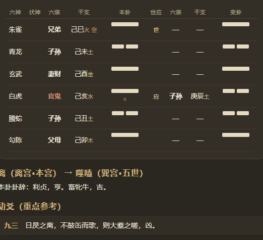
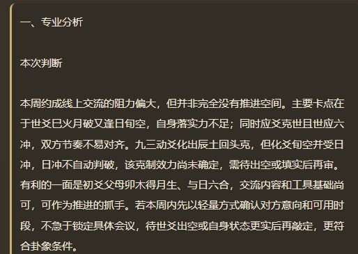

# 测了吗 · AI 六爻

测了吗（aisixyao.cn）是一款可以自己部署的中文六爻排盘与 AI 辅助解卦工具。你可以拿三枚硬币投六次，把结果逐爻录入，也可以在网页中摇卦。程序先算出本卦、动爻和变卦。想看解读时，再把问题和已经排好的卦盘交给 DeepSeek，阅读专业分析和白话说明。[打开官网](https://aisixyao.cn/) · [六次投币录入教程](https://aisixyao.cn/guide/three-coins)

## 用一组硬币结果试一遍

1. 在首页输入并确认所测之事。要复现下面的盘，手动起卦时间选北京时间 **2026 年 11 月 20 日 12:00:00**。
2. 从最下面的初爻往上，六次背面数依次录为 **1、2、3、1、2、1**。本站把字面记正、花纹面记背。
3. 点「排盘」。本卦是**离为火**，第三爻为老阳，其余五爻保持原样。第三爻由阳变阴，下卦由离变震，上卦仍为离，变卦为**火雷噬嗑**。[逐爻对照示例](https://aisixyao.cn/examples/li-to-shihe)
4. 登录后点「开始 AI 解卦」。先把解读提到的爻位与原盘对齐，再阅读它对所问之事的解释。



## AI 怎样使用卦盘

浏览器负责录入和排盘展示。提交解读时，Node.js 服务端根据投币记录和起卦时间重新排盘，生成六亲、世应、动变和历法等结构化依据。模型据此生成专业分析，再生成通俗解读。服务端检查所引依据，执行独立核校，并在限定次数内修正。未通过时页面提示失败并退还本次额度。排盘可以单独使用，AI 解读需要账号、可用额度和部署者配置的 API 密钥。

一次官网实测问的是能否约成开发者线上交流。AI 写到「九三动爻化出子孙辰土」，可以在原盘第三行核对到官鬼己亥水变子孙庚辰土。对交流能否约成的判断属于模型解释。相同卦盘下，另外两道关于学习的问题各尝试两次，均被依据校验拦截。这组记录展示了产品处理成功和失败请求的方式。[完整开发实测与截图](docs/case-study.md)



## 本地体验

只体验手动录入、网页摇卦和排盘时，可从仓库根目录运行以下命令，再打开 http://127.0.0.1:8080/ 。这种静态预览无需数据库或模型密钥。登录和 AI 解卦需要下节的完整服务。

```sh
python -m http.server 8080 --bind 127.0.0.1 --directory public
```

## 启动完整服务

需要 Node.js 20 或更高版本，以及带 Compose 的 Docker。完整部署由 Caddy、Node.js 和 MySQL 8.4 组成。

1. 从仓库根目录运行 `npm run setup`，生成本地 `.env`。脚本会随机生成数据库密码和后台口令，保留已有配置。
2. 在 `.env` 中填写自己的 `DEEPSEEK_API_KEY`。本机试用可保留 `SITE_ADDRESS=:80`；公网部署时填写已解析的域名，并允许 Caddy 接收 80 和 443 端口的流量。新账号试用次数由 `WELCOME_CREDITS` 配置。
3. 运行 `docker compose up -d --build`。本机默认访问 http://localhost/ 。`/healthz` 返回进程健康状态，`/readyz` 检查服务就绪状态。
4. 修改 `.env` 后再次运行 `docker compose up -d`。部署自己的域名时，同步调整 `public/` 下的 canonical、站点地图和 robots 中的官网地址。

提交 AI 请求时，服务会将所问问题和卦盘发送给配置的 AI 服务商，并在自己的数据库中记录相关数据。使用本项目进行传统文化学习和娱乐时，示例问题就足以体验流程。

## 开发与测试

```sh
npm ci
npm test
```

默认测试使用 Node 的测试运行器，覆盖铜钱与动爻规则、手动时间、前后端排盘一致性、AI 依据校验、额度及失败退款。需要独立本地 MySQL 的集成测试由环境变量 `MYSQL_TEST_PORT` 启用，具体条件见对应测试文件。

| 路径 | 内容 |
| --- | --- |
| `public/` | 网页界面、排盘引擎、经文、录入教程及示例 |
| `src/liuyao-rules.js` | 从卦盘生成供 AI 引用的事实 |
| `src/grounded-interpreter.js` | 专业分析、通俗解读、核校与有限纠错 |
| `src/server.js`、`src/mysql-store.js` | HTTP 服务、账号接入、持久化及记录 |
| `test/` | 规则、服务、界面逻辑及数据库测试 |

## 许可与经文版本

项目自有代码采用 MIT 许可证。开源版所用《周易》数据整理自明确以 MIT 发布的 yijing-data，异体字及标点可能和官网整理本略有不同。历法库使用 lunar-javascript。许可和来源保存在仓库中。[MIT 许可证](LICENSE) · [第三方声明](THIRD_PARTY_NOTICES.md)
