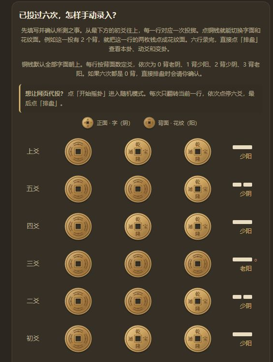
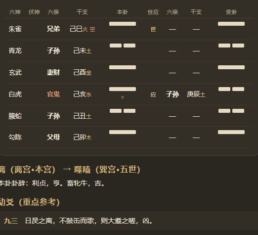
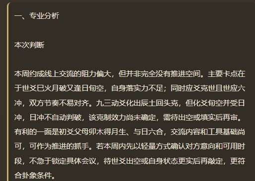

# 开发实测 · AI 在解哪一卦？

三枚硬币投了六次，读 AI 解卦之前，可以先问一个能用纸笔回答的问题：究竟哪一爻在动？

这次在「测了吗」官网手动输入六次背面数 **1、2、3、1、2、1**，并固定北京时间 **2026 年 11 月 20 日 12:00:00**。从初爻往上看，只有第三投是三个背，按本站规则记为老阳。六行排出来是离为火；只把第三爻翻成阴，下卦由离变震，变卦便是火雷噬嗑。[在官网核对六行输入](https://aisixyao.cn/examples/li-to-shihe)

接着用同一张盘问：「我准备和其他开发者约一次线上交流，讨论自己做的六爻排盘工具。本周能把这次交流约成吗？」官网使用当时界面可选的 Flash 模型，返回专业分析和通俗解读。

> 九三动爻化出子孙辰土回头克本爻

这是实际回复的节选。核对时先看原盘，从下往上第三行带动爻标记，左列是官鬼己亥水，右列是子孙庚辰土。爻位和变爻的六亲、地支都可以从截图读出来。「本周约成交流的阻力偏大」则是模型对所问事情的解释，交流能否约成仍取决于实际安排。

同一盘还试了两个问题：一个问为什么只有第三爻动，一个问能否坚持一周的手工排盘练习。各试两次，四次都触发了产品的卦象依据校验，页面说明本次不扣次数。把这四次也列出来，是为了让体验者知道真实情况下可能看到哪两种结果：一份可与原盘对读的回复，或一条本次未通过校验的提示。
